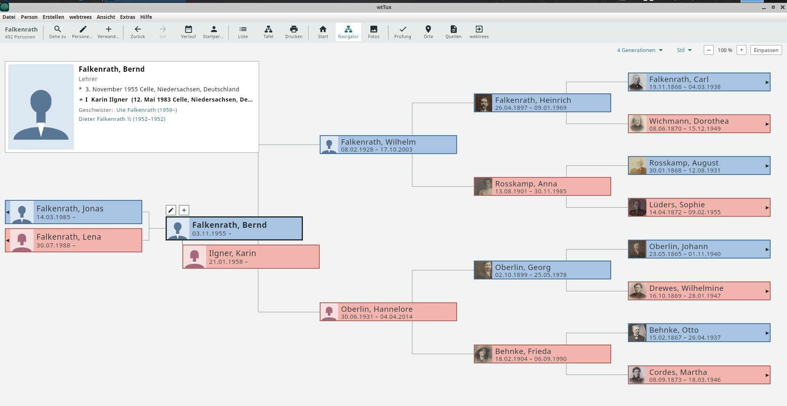

# wisetrees

**Deutsch** · [English](README.md)

Ein selbst gehosteter Genealogie-Server mit eigener JSON-Schnittstelle. Er hält Personen, Ereignisse, Orte und Quellen
als eigenes Datenmodell; GEDCOM ist das Austauschformat. Ein Ereignis wie eine Taufe ist ein Objekt, an dem
Täufling, Eltern und Paten mit ihrer Rolle hängen; Orte haben datierte Namen und eine datierte Zugehörigkeit.



## Stand

**Was geht**

- GEDCOM 5.5.1 mit GEDCOM-L einlesen. Jede Zeile wird übernommen oder bleibt als Rest an ihrer Stelle; der
  Importbericht zählt beides und nennt unsichere Ortszuordnungen.
- Die Schnittstelle [api4wisetrees v1](docs/API-V1.md) lesend: Personenliste und Suche, Person, Familie, Vorfahren,
  Nachkommen, Faktenarten, Bilder. Sichtbarkeit je Rolle (Besucher, Mitglied, Bearbeiter, Moderator, Verwalter)
  einschließlich Schutz lebender Personen.
- wtTux zeigt den Falkenrath-Demobaum aus wisetrees: Baum, Navigator, Personentafel mit Paten, Quellen und Fotos.
  wtAnd nutzt denselben Kern; der Test am Gerät steht aus.
- Konten, Rollen je Baum, Sitzungen; Betrieb als Docker-Container (nicht als root).

**Was fehlt**

- Schreiben (Fakten, Personen, Medien) und das Freigeben offener Änderungen.
- GEDCOM-Export und der Rundlauf-Test Import → Export → Import.
- GEDCOM 7.0, Zeichensatz ANSEL.
- PostgreSQL als Alternative zu SQLite.

**Als Nächstes**

Schreiben in v1 (mit offenen Änderungen, die nur Bearbeiter und höher sehen), danach der GEDCOM-Export. Das Konzept
mit allen Entscheidungen steht in [docs/KONZEPT.md](docs/KONZEPT.md).

## Ausprobieren

```sh
mkdir -p data
docker compose up -d --build
docker compose exec wisetrees python3 /app/werkzeuge/konten.py anlegen admin --admin
cp meinbaum.ged data/ && docker compose exec wisetrees python3 /app/werkzeuge/importieren.py meinbaum /data/meinbaum.ged
```

Danach zeigt `http://<host>:8099/index.php` die Startseite; die Seite „App verbinden“ nennt die Adresse für die
Apps. Bäume liegen als `data/baeume/<name>.wise` (SQLite), Bilder unter `data/medien/<name>/`.

Tests (Python 3.11):

```sh
uv venv -p 3.11 .venv && uv pip install -p .venv/bin/python -r requirements-dev.txt
.venv/bin/python -m pytest backend/tests      # Unit-Tests
.venv/bin/python -m vertrag.wisetrees         # Vertragstests der Schnittstelle
```

## Mitmachen

Ideen und Fehlerberichte sind willkommen, siehe [CONTRIBUTING.md](CONTRIBUTING.md).

## Lizenz

[AGPL-3.0-only](LICENSE). Abhängigkeiten und ihre Lizenzen: [docs/DEPENDENCIES.md](docs/DEPENDENCIES.md).

Entwickelt mit Claude Code.
