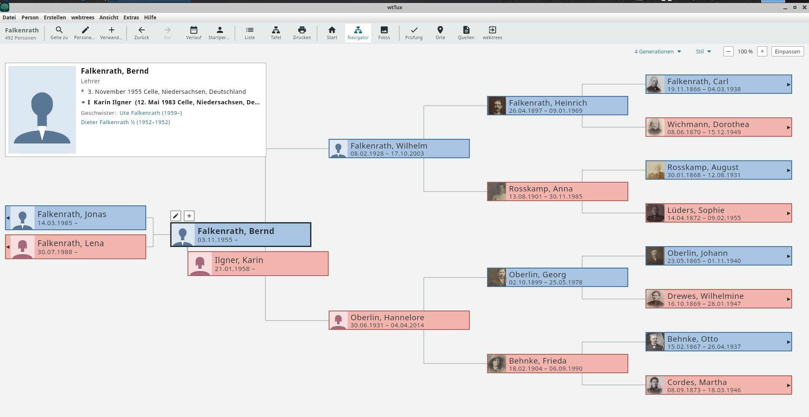

# wisetrees

[Deutsch](README.de.md) · **English**

A self-hosted genealogy server with its own JSON interface. It keeps individuals, events, places and sources in its
own data model; GEDCOM is the exchange format. An event such as a baptism is one object, with the child, the parents
and the godparents attached in their roles; places have dated names and a dated hierarchy.



## Status

**What works**

- Importing GEDCOM 5.5.1 with GEDCOM-L. Every line is either taken over or kept as a remainder in its place; the
  import report counts both and lists uncertain place assignments.
- The interface [api4wisetrees v1](docs/API-V1.md), read-only: list and search of individuals, individual, family,
  ancestors, descendants, fact types, images. Visibility per role (visitor, member, editor, moderator, manager)
  including protection of living people.
- wtTux shows the Falkenrath demo tree from wisetrees: tree, navigator, person panel with godparents, sources
  and photos. wtAnd uses the same core; a test on a device is still to come.
- Accounts, roles per tree, sessions; runs as a Docker container (not as root).
- Administration in the browser for administrators: create accounts, set passwords and roles, upload and import
  GEDCOM with the import report, delete trees. Every account can change its own password there.

**What is missing**

- Writing (facts, individuals, media) and accepting pending changes.
- GEDCOM export and the round-trip test import → export → import.
- GEDCOM 7.0, ANSEL character set.
- PostgreSQL as an alternative to SQLite.

**Next**

Writing in v1 (with pending changes visible only to editors and above), then GEDCOM export. The concept with all
decisions is in [docs/KONZEPT.md](docs/KONZEPT.md) (German).

## Try it

```sh
mkdir -p data
docker compose up -d --build
docker compose logs wisetrees     # shows the setup code on first start
```

Then open `http://<host>:8099/index.php` and go to “Verwaltung” (administration): on first use, the setup code
creates the first administrator account. After that, further accounts and GEDCOM imports are done there; the page
“App verbinden” gives the address for the apps.
Trees are stored as `data/baeume/<name>.wise` (SQLite), images under `data/medien/<name>/`.

Tests (Python 3.11):

```sh
uv venv -p 3.11 .venv && uv pip install -p .venv/bin/python -r requirements-dev.txt
.venv/bin/python -m pytest backend/tests      # unit tests
.venv/bin/python -m vertrag.wisetrees         # contract tests of the interface
```

## Contributing

Ideas and bug reports are welcome, see [CONTRIBUTING.md](CONTRIBUTING.md).

## Licence

[AGPL-3.0-only](LICENSE). Dependencies and their licences: [docs/DEPENDENCIES.md](docs/DEPENDENCIES.md).

Developed with Claude Code.
